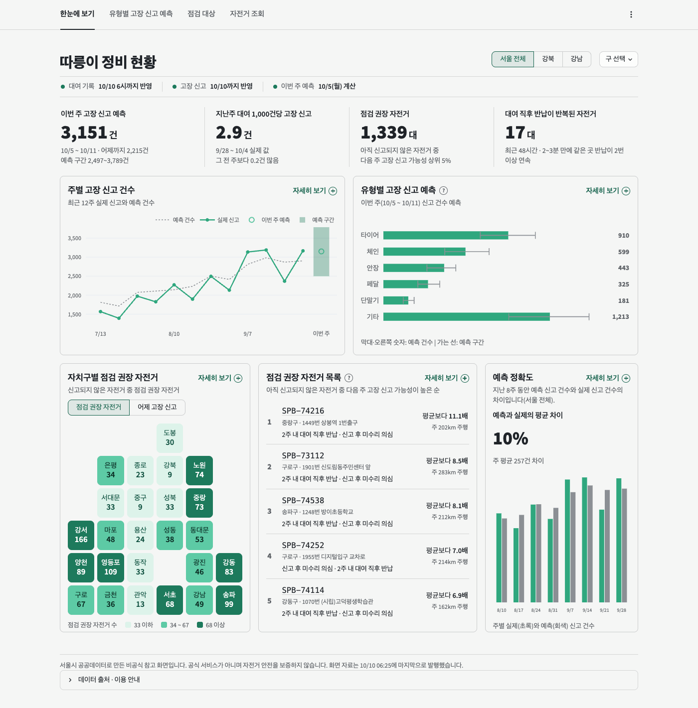
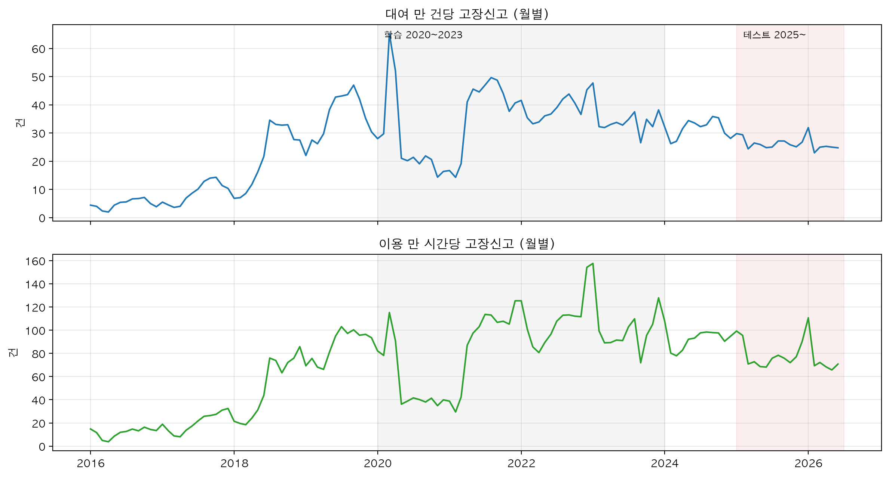
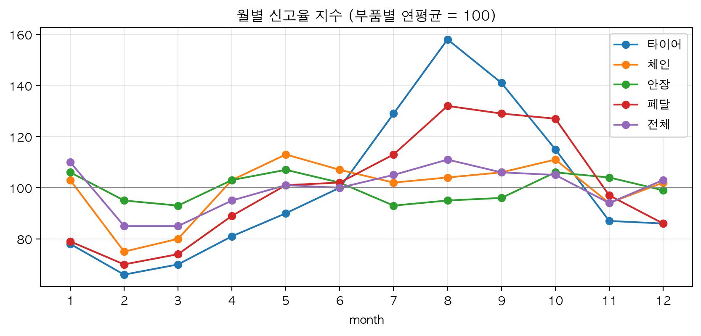
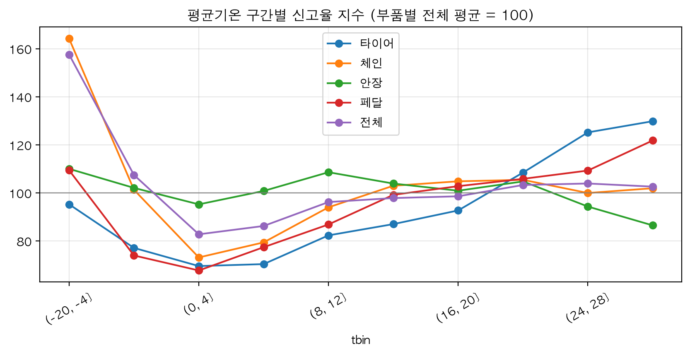
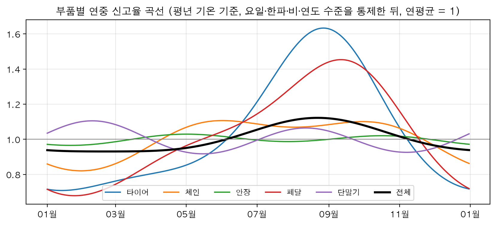
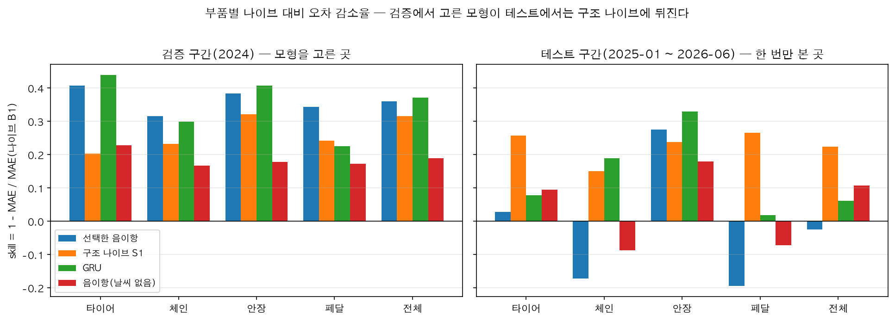
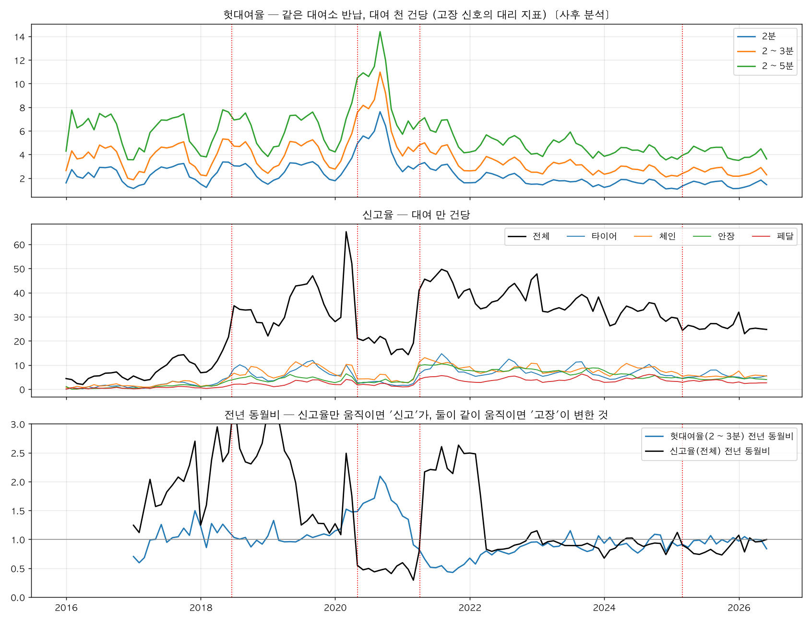
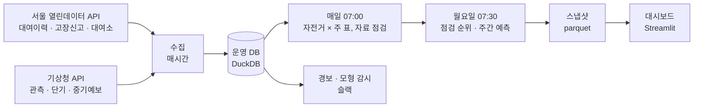
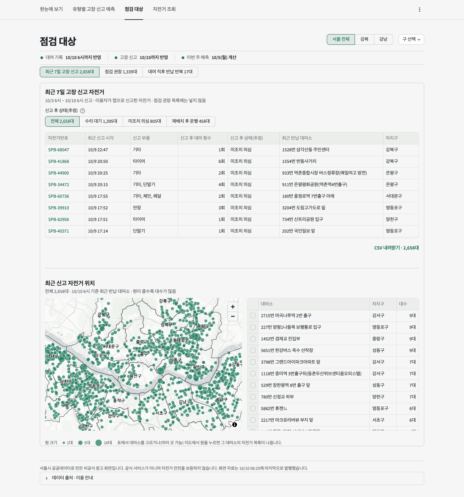

# 따릉이 고장신고 분석

서울시 공공자전거 따릉이의 고장신고를 공개 자료로 분석하고, 다음 주에 유형별로 몇 건이 들어올지와 어느 자전거부터 점검할지를 정비 담당자에게 보여 주는 화면까지 만든 프로젝트다.

## 요약

따릉이에는 한 해 10만 ~ 16만 건의 고장신고가 들어온다. 정비는 주로 신고를 따라 움직이고 정비 인력은 60명에 머물러 있다. 같은 인력으로 더 일찍 손보려면 다음 주에 어떤 신고가 얼마나 들어올지와 어느 자전거부터 볼지를 미리 알아야 한다. 이 프로젝트는 공개 자료만으로 그 두 가지를 얼마나 맞힐 수 있는지 확인했다.

자료는 고장신고 102만 행(2016 ~ 2026년 상반기)과 대여이력 2.77억 건, 기상 관측과 기상청의 과거 예보다. 신고 건수는 자전거를 많이 타는 날에 같이 늘기 때문에, 건수 대신 대여 1만 건당 신고 건수(신고율)를 분석 단위로 삼고 음이항 회귀(건수 자료에 쓰는 회귀)로 요일·계절·날씨의 영향을 추정했다. 예측은 "지난주 값 그대로"라는 단순 기준과 견줬다. 모형을 고르는 데 쓰지 않은 마지막 1년 반(2025-01 ~ 2026-06, 테스트 구간)은 모형을 고정한 뒤 한 번만 채점했다.

결과는 세 가지다. 첫째, 주간 신고 건수 변동의 80%(유형별 70 ~ 85%)는 대여량만으로 설명된다. 신고율 쪽에서 크게 움직이는 것은 어느 달에 한꺼번에 바뀌는 수준(2021년 4월에 한 달 사이 약 2배), 타이어의 계절성(8월이 2월의 2.4배), 한파(1.41배)다. 둘째, 2024년 자료로 고른 예측 모형은 테스트 구간에서 단순 기준을 고르게 넘지 못했다. 단순 기준보다 오차를 줄인 정도(개선율)가 대상(전체와 네 유형)에 따라 −19.4 ~ 27.6%였고, 음수는 단순 기준보다 나빴다는 뜻이다. 원인은 신고율 수준의 변화였다. 최근 4주 신고율에 대여량 예측을 곱하기만 하는 방식(이하 최근 신고율 방식)은 같은 구간에서 단순 기준보다 오차가 15.0 ~ 26.6% 작았다. 셋째, 자전거별 점검 순위는 미리 정한 통과 기준을 넘지 못했다. 모형이 낸 기대 신고 수로 줄을 세우면 상위 1,000대의 12.4%가 다음 주에 신고돼 무작위(4.1%)의 3배였지만, 최근 주행거리 순(11.2%)보다 조금 높은 데 그쳤다. 테스트 전에 기본으로 정해 둔 1km당 위험률 순은 9.7%로 주행거리 순보다 낮았다.

이 결과를 바탕으로 매시간 수집부터 주간 예측, 점검 목록, 화면까지 잇는 파이프라인을 만들어 서버 한 대에서 운영하고 있다. 정비 쪽에서 쓸 수 있는 것은 유형별 다음 주 신고 건수와 그 범위, 아직 신고되지 않은 자전거의 점검 순서, 빌리자마자 반납이 되풀이된 자전거의 목록이다. 고장신고가 확인된 고장이 아니라는 점이 분석 전체의 전제이자 가장 큰 한계다. 운영에 올린 최근 신고율 방식은 테스트 결과를 본 뒤에 골랐고, 실제로 내보낸 예측의 성적은 2026년 10월 12일 주부터 쌓기 때문에 아직 없다. 정비 현장에서 써 본 적도 없다.

- 화면: <https://ttareungi-care.duckdns.org> (서울시·서울시설공단과 무관한 비공식 화면)
- 자료: 서울 열린데이터광장, 기상청. 자료 기간 2016-01 ~ 2026-06, 그 뒤는 API로 수집
- 작업 기간: 2026-09-29 ~ 2026-10-10
- 도구: Python(pandas, statsmodels, LightGBM, PyTorch), DuckDB, Streamlit, systemd, GitHub Actions



## 목차

1. [배경과 목적](#1-배경과-목적)
2. [데이터 수집](#2-데이터-수집)
3. [품질 점검과 전처리](#3-품질-점검과-전처리)
4. [탐색적 분석](#4-탐색적-분석)
5. [모델링](#5-모델링)
6. [평가](#6-평가)
7. [운영 파이프라인과 대시보드](#7-운영-파이프라인과-대시보드)
8. [알아낸 것과 한계](#8-알아낸-것과-한계)

[저장소 구성](#저장소-구성) · [실행](#실행) · [문서](#문서) · [자료 출처](#자료-출처)

결과만 보려면 [8장](#8-알아낸-것과-한계)으로 가면 된다. 2 ~ 7장은 장마다(5장은 절마다) 맨 위에 그 단계에서 알아낸 것을 먼저 적고, 한 일과 판단 근거를 그 뒤에 두었다.

## 1. 배경과 목적

따릉이 정비는 주로 이용자의 신고를 따라 움직인다. 이 프로젝트의 목적은 그 순서를 앞당기는 데 필요한 두 가지, 곧 다음 주에 어떤 유형의 신고가 몇 건 들어올지와 어느 자전거부터 볼지를 공개 자료만으로 미리 알 수 있는지 확인하는 것이다. 아래는 그것이 왜 필요한지의 근거다.

### 얼마나 타고, 얼마나 신고되나

따릉이는 자전거 45,000대, 대여소 약 2,800곳 규모다([서울시설공단 운영 현황](https://sisul.or.kr/open_content/traffic/bikeseoul.jsp), 2025년). 2024년 한 해에 4,385만 번 빌려졌고, 이용자가 넣은 고장신고는 141,337건이었다.

| 연도 | 대여(만 건) | 고장신고(건) | 대여 1만 건당 신고 |
| --- | ---: | ---: | ---: |
| 2021 | 3,205 | 131,725 | 41.1 |
| 2022 | 4,095 | 158,009 | 38.6 |
| 2023 | 4,491 | 151,528 | 33.7 |
| 2024 | 4,385 | 141,337 | 32.2 |
| 2025 | 3,737 | 97,838 | 26.2 |
| 2026 상반기 | 1,798 | 45,666 | 25.4 |

고장신고는 자전거번호와 등록일시가 같은 행을 한 건으로 센 값이다(3장).

### 왜 미리 알아야 하나

이용자가 앱이나 콜센터로 고장을 신고하면 수거해서 고치고 다시 배치한다. 이 방식에는 빈틈이 있다.

**사람이 한정돼 있다.** 자전거는 2016년 5,600대에서 45,000대로 늘었는데 정비 인력은 2022년부터 60명 그대로여서, 한 사람이 750대를 맡는다([아이뉴스24, 2025-06-25](https://www.inews24.com/view/1856863)).

**신고된 자전거가 곧바로 빠지지 않는다.** 대여이력으로 신고 뒤를 따라가 보았다. 2025-07 ~ 11의 신고 44,954건(같은 자전거·같은 유형의 48시간 안 재신고는 한 건으로 묶은 수) 가운데 29.9%는 24시간 안에 다시 대여됐다. 1시간 안에 다시 나간 983건은 96.0%가 신고 직전에 반납된 그 대여소에서 출발했다. 그 사이에 현장에서 고쳤는지는 대여 기록으로 알 수 없다. 다만 다시 나가기까지 하루 넘게 걸린 자전거끼리 견주면, 그 자리에서 다시 나간 쪽이 다른 곳으로 옮겨졌다가 나온 쪽보다 7일 안에 또 신고되는 비율이 높았다(24 ~ 48시간 뒤 17.3% 대 10.9%, 2 ~ 7일 뒤 18.8% 대 8.7%). 6시간 안에 다시 나간 경우에는 이 차이가 없었다.

**신고가 고장을 다 잡지는 못하는 것으로 보인다.** 한 정비센터는 실제로 수거해 가는 자전거가 접수된 것의 2배쯤이라고 했다([헤럴드경제, 2026-09-29](https://biz.heraldcorp.com/article/10887336), 센터 한 곳의 설명). 대여 기록에도 흔적이 남는다. 빌린 대여소에 2 ~ 3분 만에 그대로 반납한 대여(이하 헛대여)가 두 번 잇달은 자전거는 46.0%가 7일 안에 신고됐다(2023-07 ~ 2025-12). 같은 기간에 아무 대여나 골랐을 때는 8.9%다. 7일 안에 신고된 경우만 보면 두 번째 헛대여부터 신고까지 중앙값으로 10.6시간이 걸렸다. 이런 일은 2년 반 동안 7,817번으로 드물지만(주에 60번쯤), 신고보다 먼저 대여 기록에 흔적을 남기는 고장이 있다는 것을 보여 준다.

**고치지 못한 자전거는 사고로 이어질 수 있다.** 서울시의원이 공단에서 받은 최근 3년 자료로는 따릉이 안전사고 2,068건 가운데 138건(6.7%)이 자전거 하자 등 자체 문제였다([더팩트, 2025-09-06](https://news.tf.co.kr/read/life/2241109.htm)). 비중은 작아도, 정비가 늦으면 불편으로 끝나지 않고 사람이 다칠 수 있다.

### 이 프로젝트가 답하려는 것

공유자전거에서 같은 문제를 다룬 연구가 있다. Grau-Escolano 외(2024)는 바르셀로나 공유자전거의 이용 기록과 정비 기록으로 브레이크 패드·바퀴살·체인의 다음 정비 시점을 예측했고, 가장 영향이 큰 변수는 누적 주행거리였다. Kaspi 외(2016)는 대여 기록만으로 쓸 수 없는 자전거일 확률을 추정했다. 대여 기록에 남는 흔적으로 문제 있는 자전거를 찾는다는 점에서 이 프로젝트의 헛대여와 방향이 같다. 따릉이는 정비 기록이 공개돼 있지 않아서 이용자 신고를 정답 자리에 놓았다.

같은 인력으로 고장 난 자전거를 더 일찍 손보려면 다음 주에 어떤 유형의 신고가 몇 건 들어올지(부품과 인력 준비), 어느 자전거부터 볼지(점검 순서)를 미리 알아야 한다. 그 앞에 신고 건수가 무엇에 따라 움직이는지부터 알아야 한다. 그래서 질문을 셋으로 세웠다.

1. 신고는 무엇에 따라 늘고 주나.
2. 유형별 다음 주 신고 건수를, 지난주 값을 그대로 쓰는 것보다 잘 맞힐 수 있나.
3. 자전거 한 대 한 대에 점검 순서를 매길 수 있나.

고장신고는 이용자가 넣은 신고이지 확인된 고장이 아니다. 이 프로젝트가 맞히는 것은 고장 날 자전거가 아니라 신고가 들어올 자전거이고, 글에서도 고장률 대신 신고율이라고 쓴다.

<details>
<summary>숫자 출처</summary>

연도별 값은 `output/tables/yearly_summary.csv`, 신고 뒤 재대여는 `rb_13_after_report.csv`, 헛대여 뒤 신고 비율과 신고까지의 시간은 `risk_alert_valid.csv`에서 왔다. 인력과 사고 숫자는 위 보도를 인용한 것이다.

</details>

## 2. 데이터 수집

분석에 쓴 자료는 모두 공개 자료다. 2026년 6월까지는 파일로 받았고 그 뒤는 API로 받는다. 2026-07-01 ~ 10-04 구간은 한꺼번에 받아 채웠고, 지금은 예약 작업이 매시간 받는다(예약은 2026-10-09에 걸었다).

**이 단계에서 알아낸 것:**

- 공개 자료만으로 10년 반의 신고와 대여를 날짜로 이을 수 있다. 자전거 한 대 단위로는 대여이력을 한 건씩 적재한 2023-07 이후를 번호로 이었다.
- 한 달 표본으로 내린 판단은 전 기간에서 뒤집힐 수 있다. 사전 점검에서는 2026년 1월 한 달의 거리 기록이 멀쩡한 것을 보고 신고율의 분모를 이동거리로 정했다. 전 기간을 합치자 거리 기록이 깨진 기간이 나와서(3장) 결정을 미뤘고, 회귀에서 대여건수·이용시간·이동거리를 견준 뒤 대여건수로 바꿨다(5.1).

| 자료 | 출처 | 기간 | 규모 | 쓰임 |
| --- | --- | --- | --- | --- |
| 고장신고 내역 | 서울 열린데이터광장(반기 파일, Open API) | 2016-01 ~ 2026-06 | 1,019,964행(신고 894,972건) | 맞히려는 값 |
| 대여이력 | 서울 열린데이터광장(월 파일 130개) | 2015-09 ~ 2026-06 | 약 2.77억 건 | 대여량, 자전거별 이용 |
| 이용정보(일별), 일별 대여건수 | 서울 열린데이터광장 | 2016-01 ~ 2026-06 | 날짜별 집계 | 대여건수, 이용시간, 이동거리 |
| 기상 관측 | 기상청 ASOS 서울(108) | 2015 ~ 2026-06 | 일자료 | 날씨 변수 |
| 과거 예보 | 기상청 단기·중기예보 | 2021-04 ~ | 발표 시각별 | 그날 아침에 볼 수 있던 예보 |
| 공휴일 | 공공데이터포털 특일정보 | 2016 ~ 2026 | 날짜별 | 달력 변수 |
| 외부 사건 연표 | 서울시·공단 발표와 보도를 직접 정리 | 2015 ~ 2026 | 56건 | 수준 변화의 해석 |

| 판단 | 근거 |
| --- | --- |
| 과거는 반기 파일로 받고 그 뒤는 Open API로 잇는다 | 2026년 6월을 두 경로로 받아 비교하니 11,548행이 모두 같았다 |
| 자전거 한 대 단위의 분석까지 간다 | 2026년 1월 후반의 신고 3,076행으로 재 보니 자전거번호가 같은 달 대여이력에 있는 비율이 99.87%였다. 측정하기 전에 정해 둔 통과 기준은 90%였다 |
| 날씨는 관측값과 별도로 과거의 예보를 모은다 | 운영에서 쓸 수 있는 날씨는 예보뿐이다. 관측값으로 평가하면 성적이 실제보다 좋게 나온다(5.2) |
| 원본은 고치지 않고, 읽는 규칙을 코드에 둔다 | 같은 자료도 해마다 형식이 다르다. 확장자만 csv인 엑셀이 섞여 있고, 2015 ~ 2017년에는 연 합계가 같은 대여·반납 내역이 따로 있어 둘 다 읽으면 대여건수가 2배가 된다 |

<details>
<summary>숫자 출처</summary>

행 수와 신고 건수는 `output/tables/yearly_summary.csv`의 합계다. 11,548행과 99.87%는 `docs/phase0_result.md`, 측정하기 전에 정한 통과 기준은 `docs/runbook/01_단계0_사전검증.md`, 월 파일 수는 `docs/load_log.csv`, API로 채운 구간과 수집 작업은 `docs/pipeline.md`, 사건 연표는 `data/raw/external/events.csv`에 있다.

</details>

## 3. 품질 점검과 전처리

원본을 읽어 표 두 개를 만들었다. 하루를 한 행으로 하는 날짜별 표와, 자전거 한 대의 한 주를 한 행으로 하는 자전거 × 주 표다.

**이 단계에서 알아낸 것:**

- 발표되는 "고장신고 건수"는 유형까지 센 행 수여서 실제 신고 횟수보다 14% 크다.
- 신고와 대여의 빈 곳은 추정으로 메우지 않아도 됐다. 같은 기관의 다른 공개 경로(API, 건별 원본)에 실제 값이 있었고, 실제 값이 없는 곳은 비우거나 뺐다. 추정으로 채운 것은 기상 관측이 빠진 27일뿐이다(앞뒤 날을 직선으로 이었고 표시를 남겼다).
- 자전거의 나이는 대부분 알 수 없다. 번호가 새로 붙은 시기가 있어서 새 번호를 새 자전거로 읽으면 안 된다.
- 신고 뒤에는 대여가 한동안 끊긴다. 대여와 다음 대여 사이는 평소 중앙값으로 1시간인데, 신고 뒤 다음 대여까지는 64시간이다. 그래도 열에 셋은 하루 안에 다시 나간다(1장).

### 3.1 날짜별 표

2016-01-01 ~ 2026-06-30의 3,834일 × 75열이다(`data/processed/daily_master_v2`).

원본의 신고 유형은 여덟 가지인데 잠금장치와 파손은 2019년부터 한 건도 없어서, 이 글에서는 타이어·체인·안장·페달·단말기·기타 여섯을 다룬다. 예측 모형을 고르고 평가한 대상은 전체와 앞의 네 유형이다. 회귀(5.1)에서는 단말기도 같이 보았고, 운영 예측에는 뒤에 단말기와 기타를 더했다(6.5). 2024년 신고 행의 69%가 네 유형이고 기타가 27%, 단말기가 4%다.

| 찾은 문제 | 처리 | 근거 |
| --- | --- | --- |
| 한 행이 신고 1건이 아니라 신고 1건 × 고장유형 1개다 | 전체는 신고 건수(자전거번호와 등록일시가 같으면 1건)로, 유형별은 행 수로 센다 | 행 수가 신고 건수보다 14.0% 많다. 공단이 발표하는 건수(2024년 162,058건)는 행 수(161,846행)와 0.1% 차이라 행 기준으로 보인다 |
| 반기 파일의 마지막 날이 통째로 비어 있다(6일) | Open API에서 그날의 실제 신고 1,372행을 받아 채웠다 | 앞뒤 날은 수백 행씩 있다. API로 함께 받은 다음 날의 행 수가 6일 모두 파일과 같았다 |
| 같은 고장을 여러 번 신고한 것으로 보이는 행 | 같은 자전거·같은 유형이 48시간 안에 다시 신고되면 표시한다(3.1%) | 주 분석에는 그대로 두고 민감도 분석과 자전거별 모형의 목표값에만 쓴다. 타이어와 체인을 병합한 값으로 다시 맞춰도 한파 배수가 1.33 대 1.35, 1.62 대 1.63으로 거의 같았다 |
| 운영이 멈춘 날이 3일 있다 | 신고율 분석과 학습에서 빼고, 평균으로 메우지 않는다 | 2022-08-09(폭우)의 대여는 482건이고 이튿날은 108,151건이다. 넣으면 날씨 효과를 잘못 배우고, 메우면 없던 대여를 만든다 |
| 신고가 갑자기 적게 접수된 34일이 있다(2023-09-07 ~ 10-10) | 탐색에는 그대로 두고, 회귀와 예측 모형의 학습에서는 뺀다 | 앱 접속 장애 직후였고 대여는 정상인데 신고율만 직전 34일의 37.9에서 24.6으로 내렸다. 요일·날씨 효과에는 영향이 없지만 수준과 계절을 추정할 때는 값을 끌어내린다 |
| 이용시간·이동거리 요약 파일에 빠진 날과 잘린 달이 있다 | 564일을 대여이력에서 다시 합산한 값으로 바꾸고 출처를 열에 남겼다 | 두 출처가 모두 멀쩡한 날에는 거리와 시간의 합계가 소수 넷째 자리까지 같았다 |
| 이동거리가 0으로 기록된 대여가 많은 기간이 있다(2020-03부터 늘어 2020-08 ~ 12에는 약 90%, 2021-08 ~ 2022-03에는 11 ~ 22%) | 그날 기록의 10% 이상이 0인 561일은 거리를 비워 둔다 | 평소에는 1 ~ 4%다. 원본이 0이라 되살릴 수 없다 |
| 자전거번호가 2020 ~ 2022-02에 새로 붙었다 | 번호가 처음 나타난 날을 도입일로 쓰는 것은 2022-03 이후 번호로 한정한다 | 2024년 이후 대여된 번호 가운데 2019년 이전 번호가 하나도 없다 |

만든 표는 열 가지 항목으로 검증해 저장한다(`output/tables/validation.csv`). 날짜 중복 0, 대여건수 빈칸 0, 2019년 이후 신고가 0건인 날 0이다.

### 3.2 자전거 × 주 표

대여이력 1.23억 건(2023-07 ~ 2026-06)을 한 건씩 적재해 만들었다. 5,477,654행이고 자전거 47,783대, 130주(2024-01 ~ 2026-06)다. 맞히려는 값은 다음 주 신고 건수이고, 한 건이라도 있는 행은 전체의 4.8%다.

| 판단 | 근거 |
| --- | --- |
| 이상해 보이는 대여를 지우지 않고 표시만 한다 | 몇 분 만의 반납에는 자전거에 문제가 있어 돌려놓은 경우가 섞여 있다. 지우면 그 신호를 잃는다. 지운 것은 완전 중복 13,244건과 번호 없는 261행뿐이다 |
| 헛대여를 "같은 대여소 반납, 이용시간 2 ~ 3분"으로 정의한다 | 2분 미만 기록은 2026년 파일에만 있어서, 아래쪽을 자르지 않으면 2026년만 부풀어 보인다. 위쪽은 길수록 마음이 바뀐 대여가 섞인다. 이 정의로 전체 대여의 0.27%다 |
| 설명변수는 그 주 끝까지의 정보로만 만든다 | 다음 주 주행거리처럼 맞히려는 값 쪽 정보는 설명변수에서 뺐다. 대여소 군집도 학습 구간이 끝나는 2025-06-30까지의 통행으로만 만들었다 |
| 신고 위치는 대여이력으로 추정한다 | 신고 직전에 마지막으로 반납된 대여소를 신고 위치로 본다. 신고 행의 99.4%에서 찾았다. 같은 방법으로 신고 뒤 다음 대여까지의 시간도 쟀다(중앙값 64시간) |

<details>
<summary>숫자 출처</summary>

`output/tables/validation.csv`, `yearly_summary.csv`, `regime_part_by_year.csv`, `reg_robust.csv`, `panel_2a2_checks.csv`, `panel_2a7_checks.csv`, `panel_2a8_checks.csv`, `panel_2a9_checks.csv`. 1,372행, 564일, 3.1%, 거리가 0으로 기록된 비율은 `docs/notes/01_데이터전처리_메모.md`에 있다. 신고가 적게 접수된 34일의 신고율은 `data/processed/daily_master_v2.csv`에서 계산했고, 그 기간이 무엇에 영향을 주는지는 `docs/notes/02_EDA_메모.md`에 있다.

</details>

## 4. 탐색적 분석

요일·계절·날씨는 2021-04-08 ~ 2024-12-31(운영이 멈춘 하루를 뺀 1,363일)로 보았다. 시작일을 이렇게 잡은 까닭은 4.2에 있다. 수준 변화만은 2016년부터 전 기간을 보았다. 테스트 구간(2025-01 이후)은 월별 추이 말고는 쓰지 않았다.

**이 단계에서 알아낸 것:**

- 신고 건수는 대부분 이용량을 따라 움직인다. 신고율로 바꿔야 신고가 더 많이 나오는 조건이 보인다.
- 신고율에서 가장 크게 움직인 것은 수준이다. 어느 달에 한꺼번에 바뀌고, 날씨나 계절보다 폭이 크다.
- 타이어는 여름에 겨울의 2.4배까지 오르고 안장은 연중 거의 같다.
- 기온에서는 한파만 남았다. 요일 효과는 뚜렷하고 기간이 달라도 같았다.

### 4.1 건수 대신 신고율을 본다

일별 신고 건수와 대여 건수의 상관은 0.887이다. 신고 건수를 그대로 보면 자전거를 많이 탄 날이 보일 뿐이다. 대여 1만 건당 신고 건수(신고율)로 바꾸면 대여 건수와의 상관이 0.050으로 사라진다.

주 단위로도 같다. 주간 신고 건수 변동 가운데 대여량만으로 설명되는 몫(R²)이 전체 0.80, 유형별 0.70 ~ 0.85다. 한 주 앞을 맞히는 간단한 실험에서도 드러난다. 지난주 건수를 그대로 쓰면 MAPE(실제값 대비 오차 비율의 평균)가 22.3%인데, 지난주 신고율에 그 주의 실제 대여량을 곱하면 7.9%로 준다. 뒤의 값은 대여량을 미리 정확히 안다고 가정한 것이라 실제 성능이 아니고, 가장 잘 됐을 때의 값이다.

그래서 분석 단위를 신고율로 잡고, 예측은 대여량 예측과 신고율로 나눠 만들었다. 결과는 모두 "지난주 값 그대로"와 나란히 적는다.

### 4.2 신고율은 계단처럼 바뀐다



위는 대여 1만 건당, 아래는 이용 1만 시간당 신고 건수다. 회색 띠는 처음 계획한 학습 구간(2020 ~ 2023), 분홍 띠는 테스트 구간이다.

신고율은 서서히 변하지 않고 어느 달에 한꺼번에 바뀐다. 2018년 6월에는 새 앱이 나온 직후에 올라 5월 16.1에서 7월 34.5가 됐다. 2020-05 ~ 2021-03에는 월 14.3 ~ 21.9로 내려앉았다가, 앱을 개편한 지 3주 뒤인 2021년 4월에 41.0이 됐다(3월 19.1, 2019년 연간 38.8). 2025년 3월부터는 다시 내려가 상반기 신고율이 전년 상반기의 0.83배다. 분모를 이용시간으로 바꿔도 같은 자리에서 바뀐다. 2020년 3 ~ 4월의 봉우리(65.2, 52.0)는 두 달에 그쳐 수준 변화로 보지 않았다.

2021년 4월의 급등은 자전거가 바뀌어서 생긴 것이 아니다. 번호가 2020년에 처음 나타난 자전거 묶음만 따로 보아도 연간 신고율이 2020년 17.4에서 2021년 43.0이 됐다. 2020년에 낮았던 것도 이 새 번호 묶음이다. 번호가 그 전에 나타난 묶음들은 그해 37 ~ 54였고(하락 전인 1 ~ 4월이 들어 있는 연간 값이다), 새 번호 자전거의 비중이 커지면서 전체가 내려갔다. 새 번호 자전거의 신고율이 왜 낮았는지는 이 표로 가르지 못한다. 헛대여와 견준 6.4에서는 신고가 덜 잡힌 기간으로 보았다.

이 그림을 보고 구간을 정했다. 학습 시작을 처음 계획한 2020년에서 2021-04-08로 늦췄다. 2022년 3월로 더 늦추는 안은 2024년 일별 MAPE가 10.1%에서 11.8%로 나빠져서 택하지 않았다. 검증은 2024년, 테스트는 2025-01 ~ 2026-06이다. 테스트 구간은 월별 추이만 미리 보고 수준이 다른 구간이라고 판정했고, 그래서 모든 예측 모형에 최근 4주 신고율을 넣기로 했다.

### 4.3 계절성은 유형마다 다르다



유형마다 열두 달 평균을 100으로 둔 지수다(가로축은 월). 타이어는 2월 66에서 8월 158로 2.4배 차이가 난다. 페달은 70 ~ 132, 체인은 75 ~ 113이고 안장은 93 ~ 107로 거의 평평하다. 그래서 모형을 유형별로 따로 맞추기로 했다. 계절은 월별 더미 대신 1년·반년 주기의 사인·코사인 네 항으로 넣었다. 학습 자료가 2년 9개월뿐이어서 변수 수를 줄이려는 것이다.

### 4.4 더위로 보였던 것은 계절이었다



계절을 떼어 내기 전의 평균이다(가로축은 평균기온 구간, ℃). 왼쪽 끝의 한파에서 체인과 전체가 솟고, 오른쪽 끝의 더운 날에 타이어와 페달이 오르는 U자 모양이다. 그런데 여름에는 원래 타이어 신고가 많다. 계절을 떼어 내려고 그날 신고율을 앞뒤 2주의 중앙값으로 나눠 다시 보았다. 평균기온 −4℃ 이하인 날은 그 무렵 평소의 1.33배이고 28℃를 넘는 날은 1.01배다. 더위 효과로 보였던 것은 여름의 계절성이었다. 그래서 기온 구간별 곡선은 넣지 않고 한파 변수를 따로 두었다. 평균기온은 선형 항 하나만 남겼다(1℃당 0.995배). 더위 변수는 유형별로 넣어 보아 AIC가 뚜렷이 나아진 안장 모형에만 남겼는데(0.93배), 유형과 변수의 조합 열 가지 가운데 뚜렷했던 것이 둘뿐이라 우연일 가능성이 있다.

### 4.5 요일 효과는 기간이 달라도 같다

같은 방법으로 요일을 보면 월요일이 그 무렵 평소의 1.10배, 토요일이 0.87배다. 2021-04 ~ 2022년과 2023 ~ 2024년으로 나눠도 요일마다 차이가 0.04 이내다. 수준이 달라져도 요일의 상대적인 크기는 유지된다. 최근 수준에 학습한 상대 효과를 곱하는 방식으로 예측할 수 있다는 근거가 됐다.

<details>
<summary>숫자 출처</summary>

`output/tables/eda_corr.csv`, `eda_weekly_decomp.csv`, `eda_weekly_naive_vs_rate.csv`, `regime_monthly.csv`, `regime_part_h1.csv`, `regime_cohort_by_year.csv`, `yearly_summary.csv`, `eda_month_index.csv`, `eda_rel_temp.csv`, `eda_rel_dow.csv`, `reg_start_valid.csv`, `reg_m4_irr.csv`, `reg_irr_by_part.csv`. 앱이 바뀐 날짜는 `data/raw/external/events.csv`, 2020년 하락의 해석은 `docs/notes/02_EDA_메모.md`, 더위 변수를 고른 과정은 `docs/notes/03_모델설계_메모.md`에 있다.

</details>

## 5. 모델링

### 5.1 신고율 요인 분석: 음이항 회귀

**이 단계에서 알아낸 것:**

- 이용량이 같아도 신고율은 한파에 1.41배, 토요일에 0.83배로 달라진다.
- 한파나 토요일은 며칠짜리 효과다. 해 전체를 옮긴 것은 수준이다. 요일·계절·날씨를 같게 놓고 보면 2024년의 신고율은 2021년(4월 8일 이후)의 0.73배다.
- 요일과 날씨로 설명하고 남은 오차는 며칠씩 같은 쪽으로 이어진다(하루 차이 자기상관 0.53). 회귀가 잡지 못한 "요즘 수준"이 있어서, 예측에는 최근 4주 신고율을 넣는다.

하루 신고 건수를 대여량과 신고율로 나누고 신고율 쪽만 설명하는 회귀를 맞췄다. 식으로는 log(기대 신고 건수) = log(대여건수) + 요일 + 공휴일 + 계절 + 날씨 + 연도 수준이다. log(대여건수)의 계수를 1로 고정했으므로(노출, offset) 나머지 계수는 신고율이 몇 배가 되는지로 읽힌다. 고정하지 않고 추정하면 1.10(1.06 ~ 1.14)으로, 대여가 10% 늘 때 신고가 11% 느는 정도라 고정해도 큰 무리는 없다고 보았다. 표본은 2021-04-08 ~ 2024-12-31에서 운영이 멈춘 하루와 신고가 적게 접수된 34일을 뺀 1,329일이다.

아래 표의 AIC는 모형이 자료에 맞는 정도를 변수 수까지 따져 매긴 값으로 낮을수록 좋다. p는 그 효과가 우연일 가능성으로 작을수록 뚜렷하다.

| 판단 | 근거 |
| --- | --- |
| 대여량을 설명변수가 아니라 노출로 둔다 | 노출 없이 맞추면 기온 계수가 0.0281이고 노출을 넣으면 0.0024다. 앞의 값은 날씨가 좋아서 많이 탄 몫이었다 |
| 포아송 분포 대신 음이항 분포를 쓴다 | 포아송은 평균과 분산이 같다고 가정하는데 실제 분산이 그 20.9배였다(과산포). 분산을 따로 두는 음이항으로 바꾸면 AIC가 35,157에서 15,649로 내려간다 |
| 노출은 대여건수로 한다 | 이용시간, 이동거리를 쓴 모형보다 AIC가 194.0, 197.6 낮고 2024년 일별 MAPE도 11.2% 대 14.8%, 13.7%다 |
| 표준오차는 하루하루가 서로 닮은 것(자기상관)을 감안해 넓힌다(HAC, 14일) | 감안하지 않으면 눈 온 날의 효과가 p 0.002로 뚜렷해 보이는데 감안하면 0.09다. 길이를 7일, 28일로 바꿔도 같다 |
| 한파는 두 변수로 넣는다(−4℃ 이하 여부, 겨울 기온이 평년과 다른 정도) | 둘 다 넣은 모형의 AIC가 가장 낮다(−4℃ 이하 여부만 넣은 모형보다 94 낮다). 2024년 일별 MAPE는 한파 변수가 없을 때 12.7%, 하나만 넣으면 10.6%, 둘 다 넣으면 10.3%다 |

이 단계의 MAPE는 변수를 고르려고 본 값이라 표본과 변수 묶음이 판단마다 조금 다르다. 같은 줄의 값끼리만 견준다.

전체 신고에 맞춘 결과다. 배수는 다른 조건이 같을 때 신고율이 몇 배인지를 뜻한다(발생률비, IRR).

| 조건 | 신고율 배수 | 95% 신뢰구간 |
| --- | ---: | --- |
| 한파(평균기온 −4℃ 이하) | 1.41 | 1.27 ~ 1.58 |
| 쉬는 날 다음 첫 근무일 | 1.07 | 1.03 ~ 1.11 |
| 공휴일 | 0.89 | 0.85 ~ 0.92 |
| 일요일(월요일 대비) | 0.86 | 0.83 ~ 0.89 |
| 토요일(월요일 대비) | 0.83 | 0.80 ~ 0.86 |
| 당일 비 10mm | 0.90 | |
| 전날 비 10mm | 1.00 | p = 0.79 |
| 2024년 수준(2021년 대비) | 0.73 | 0.70 ~ 0.76 |

4장의 값(한파 1.33배, 토요일 0.87배)은 앞뒤 2주와의 단순 비교이고, 여기는 요일·계절·다른 날씨를 함께 넣어 떼어 낸 값이라 조금 다르다. 토요일은 기준도 다르다(4장은 그 무렵 평소 대비, 여기는 월요일 대비). 수준의 0.73배도 1장 표의 연간 값으로 계산한 0.78배와 다른데, 표의 2021년에는 신고율이 낮던 1 ~ 3월이 들어 있기 때문이다.



요일·한파·비·연도 수준을 통제한 뒤의 연중 곡선이고 연평균이 1이다. 검은 굵은 선이 전체, 보라는 단말기다.

같은 식을 유형별로 따로 맞추면 반응이 갈린다. 한파의 배수는 체인 1.62, 페달 1.53, 타이어 1.33이고 안장은 1.09로 신뢰구간이 1을 포함한다. 타이어는 연중 0.71 ~ 1.63배로 움직이고 안장은 0.97 ~ 1.03배다. 전날 비는 타이어에서 1.03배, 체인에서 0.96배로 방향이 달라서 전체로는 상쇄돼 1.00이 된다.

<details>
<summary>숫자 출처</summary>

`output/tables/reg_ladder.csv`, `reg_exposure.csv`, `reg_exposure_valid.csv`, `reg_hac_sensitivity.csv`, `reg_cold.csv`, `reg_m4_irr.csv`, `reg_irr_by_part.csv`, `yearly_summary.csv`. 남은 오차의 자기상관과 노출 계수에 대한 판단은 `docs/notes/03_모델설계_메모.md`에 있다.

</details>

### 5.2 주간 신고 예측

**이 단계에서 알아낸 것:**

- 작년 값을 가져오는 예측은 수준이 해마다 바뀌는 자료에서 무너진다. 최근 값을 쓰는 예측이 강하다.
- 대여량 모형은 종류를 바꿀 때보다 학습 자료를 예보로 바꿀 때 차이가 컸다. 예보로 학습해야 "예보된 비"가 실제 대여를 얼마나 줄이는지를 배운다.
- 검증에서 개선의 큰 몫은 최근 신고율 방식(최근 4주 신고율 × 대여량 예측)에서 이미 나왔다.

과제는 매일 아침, 그날부터 7일 동안 들어올 신고 건수의 합을 맞히는 것이다. 대상은 다섯이다(전체와 타이어·체인·안장·페달 네 유형).

| 판단 | 근거 |
| --- | --- |
| 예측 시점을 매일 하나씩 둔다 | 주 1회로 하면 2024년 검증 표본이 52개뿐이고 매일이면 360개다. 이웃한 시점이 6일씩 겹치는 것은 검정에서 반영했다 |
| 미래 정보가 섞이지 않게 막는다 | 예측 시점에는 전날까지의 실적, 앞으로 7일의 달력, 그날 아침에 볼 수 있던 예보만 쓴다. 최근 수준은 맞히려는 날의 34 ~ 7일 전 28일로 계산한다. 이렇게 하면 7일째 날의 값도 예측 시점 전날까지의 실적만으로 만들어진다 |
| 앞으로 7일의 날씨는 기상청의 과거 예보로 넣는다 | 예보는 기온을 잘 맞히지만(오차의 표준편차가 당일 0.82℃, 6일 뒤 1.85℃) 먼 날의 비는 자주 놓친다(비 온 날을 놓친 비율이 당일 17.1%, 6일 뒤 67.1%). 관측값을 넣으면 오차율(절대오차의 평균 ÷ 실제값의 평균, 6.1)이 유형에 따라 0 ~ 2.1%p 낮게 나온다 |
| 대여량 모형도 예보로 학습한다 | 관측 날씨로 학습한 처음 모형에 예보를 넣으면 주간 대여량 오차율이 12.9%로, 날씨를 뺀 모형(12.5%)보다 나을 것이 없었다. 식을 손보고 예보로 학습하자 8.5%가 됐다. 지난주 대여량을 그대로 쓰면 15.2%다 |

견준 모형은 이렇다. 최근 신고율 방식(최근 4주 신고율 × 대여량 예측)은 계수를 추정하지 않고 최근 실적에 대여량 예측만 곱한다. 음이항 회귀는 5.1의 식에서 연도 수준 자리에 최근 4주 신고율을 넣은 것이다(페달만은 날씨 변수를 예보값으로 학습한 판을 골랐다). LightGBM은 결정나무를 여러 개 쌓는 기계학습 모형, GRU는 시계열용 신경망이다. 뒤의 둘은 왜 그런 값을 냈는지를 계수로 읽기 어렵다.

2024년 검증 구간의 성적이다. 숫자는 단순 기준(지난주 값 그대로)보다 오차를 몇 % 줄였는지다(6.1의 개선율).

| 모형 | 타이어 | 체인 | 안장 | 페달 | 전체 |
| --- | ---: | ---: | ---: | ---: | ---: |
| 작년 같은 주 | −42.9 | −28.2 | −81.2 | −6.6 | −26.3 |
| 최근 신고율 방식 | 20.4 | 23.2 | 32.2 | 24.3 | 31.6 |
| LightGBM | 9.0 | 23.8 | −6.0 | 24.3 | 18.9 |
| GRU | 44.0 | 30.0 | 40.7 | 22.5 | 37.1 |
| 음이항 회귀(선택) | 40.8 | 31.6 | 38.4 | 34.4 | 36.1 |

전통적인 시계열 모형인 ARIMAX는 관측 날씨를 넣은 유리한 조건에서 31.9 ~ 39.1%였다.

다섯 대상 모두 음이항 회귀로 통일했다. 미리 적어 둔 규칙(검증 개선율이 가장 높은 것, 그 2%p 안에 더 단순한 것이 있으면 그것)대로라면 타이어·안장·전체는 GRU다(안장과 전체는 표에 없는 GRU 변형이 41.3%, 38.8%로 후보 가운데 가장 높았고, 그 2%p 안에 든 더 단순한 것이 표의 GRU다). 규칙을 따르지 않은 것은 GRU와의 차이가 대상마다 엇갈렸고 GRU는 설정에 따라 성적이 5%p쯤 오르내렸기 때문이다. 음이항 회귀는 5.1과 같은 계수로 설명된다는 점도 있었다. 규칙에서 벗어난 선택이므로 GRU의 테스트 성적도 같이 적는다(6.2).

예측 구간도 손봤다. 고른 음이항 회귀가 스스로 낸 80% 구간에는 검증 구간의 실제값이 33.1 ~ 44.4%만 들었다. 대여량 예측의 오차가 빠져 있어서 너무 좁다. 검증 구간에서 실제로 빗나간 폭(상대오차의 10%, 90% 지점)으로 구간을 다시 만들었다.

<details>
<summary>숫자 출처</summary>

`output/tables/fc_valid.csv`, `fc_naive_valid.csv`, `fc_forecast_error_kma.csv`, `fc_expo_valid.csv`, `output/models/selection.csv`. GRU가 설정에 따라 오르내린 폭과 대여량 모형을 고른 과정은 `docs/notes/03_모델설계_메모.md`에 있다.

</details>

### 5.3 자전거별 신고 위험

**이 단계에서 알아낸 것:**

- 많이 달린 자전거는 신고 건수는 많지만 1km당으로는 평균보다 적다.
- 잎 수 같은 설정을 바꿔도 성적은 그대로였다. 차이는 노출을 무엇으로 두고 줄을 무엇으로 세우느냐에서 났다.
- 마지막 신고 뒤로 오래 달린 자전거일수록 1km당 신고율이 낮다.

자전거마다 다음 주 신고 건수를 맞히는 모형이다. LightGBM을 건수를 맞히도록(포아송 목적함수) 학습시키고 다음 주 주행거리의 로그를 노출로 두어, 모형이 1km당 신고율을 배우게 했다. 날짜 단위 분석(5.1)에서는 대여건수가 노출로 더 나았지만, 자전거 한 대의 마모는 달린 거리를 따른다고 보고 거리를 썼다(1장의 Grau-Escolano 외 연구에서도 가장 영향이 큰 변수가 누적 주행거리였다). 자전거 × 주 표(3.2)의 구간(2024-01 이후)에는 3.1에서 본 거리 기록의 문제가 없다. 포아송 목적함수는 건수의 평균을 맞히는 손실로만 쓴다. 5.1에서 문제 삼은 과산포는 계수의 표준오차를 흐리는 것이어서, 순위만 쓰는 여기에는 걸리지 않는다. 다음 주 주행거리는 학습할 때의 분모로만 쓰고 설명변수에는 넣지 않았다. 학습 행은 다음 주에 주행이 있는 자전거·주로 한정했다. 점수를 낼 때는 다음 주 주행거리를 알 수 없으므로, 모형이 낸 1km당 위험률을 그대로 쓰거나 최근 4주 평균 주행거리를 곱해 기대 신고 수로 바꾼다.

| 판단 | 근거 |
| --- | --- |
| 주행거리를 노출로 둔다 | 최근 4주 주행거리 순으로만 세워도 신고는 많이 잡힌다. 그런데 검증 구간에서 그 상위 5%의 1km당 신고율은 전체의 0.55배였다. 노출이 없으면 모형이 많이 타는 자전거만 찾는다 |
| 단순한 줄 세우기 다섯 가지를 먼저 채점한다 | 무작위, 최근 4주 주행거리 순, 최근 13주 신고 수 순 등이다. 모형은 이것들을 넘어야 쓸 이유가 있다 |
| 설정을 넓게 찾지 않는다 | 모형의 복잡도를 정하는 설정(잎 수, 잎의 최소 행 수)을 바꾼 아홉 조합의 검증 성적이 위험률 순 상위 1,000대 적중률로 9.0 ~ 9.1%, 1km당 신고 배수로 3.48 ~ 3.53이어서 거의 같았다 |
| 점수 두 가지를 함께 채점한다 | 1km당 위험률과 기대 신고 수다. 테스트 전에는 위험률 순을 점검 순위의 기본으로 정했고, 화면의 순위를 기대 신고 수 쪽으로 바꾼 것은 테스트 뒤다(6.6) |

변수는 36개다. 그 주의 이용량, 타는 방식(속도, 출퇴근 비중), 출발 대여소의 군집, 마지막 신고 이후 달린 거리, 나이와 누적 거리, 신고 이력과 헛대여, 차종과 달이다.

무엇이 1km당 신고율을 높이는지는 주행거리를 노출로 둔 음이항 회귀로 따로 읽었다. 마지막 신고 뒤로 오래 달린 자전거일수록 신고율이 낮았다(달린 거리의 로그 1단위당 0.87배). 신고 직후에는 같은 고장이 다시 신고되는 일이 잦고, 오래 신고 없이 달린 자전거는 원래 상태가 좋은 자전거이기 때문으로 보인다. 재배치가 잦은 자전거는 높았다(1 표준편차당 1.07배). 오르막은 예상과 달리 효과가 아주 작았고(1 표준편차당 1.01배), 빗길 주행은 신뢰구간이 넓어 효과를 가려내지 못했다(젖은 노면 1.12배, 0.91 ~ 1.37).

<details>
<summary>숫자 출처</summary>

`output/tables/risk_eval_valid.csv`, `risk_grid_all.csv`, `risk_irr_nb.csv`, `output/models/risk_spec.json`. 학습 행을 고른 방식은 `docs/notes/06_위험모형_메모.md`, 거리를 노출로 둔 설계는 `docs/reference/04_설계쟁점-7개-답변-및-문헌정리.md`에 있다.

</details>

## 6. 평가

**이 단계에서 알아낸 것:**

- 2024년 검증 구간 하나로 고른 것은 새 자료에서 뒤집힐 수 있다. 모형 선택에서 한 번, 학습 시작 시점에서 또 한 번 그랬다.
- 수준이 바뀐 구간에서는 최근 신고율 방식이 다섯 대상 가운데 넷에서 고른 회귀 모형보다 나았다(안장만 예외).
- 2025년의 신고 감소는 고장보다 신고 쪽 변화로 보인다. 체인과 안장은 가르지 못했다.
- 자전거별 순위에서 모형이 주행거리 순에 더하는 몫은 작다.

### 6.1 평가 설계

| | 학습 | 검증(모형 선택) | 테스트(한 번) |
| --- | --- | --- | --- |
| 주간 예측 | 2021-04-08 ~ 2023 | 2024 | 2025-01 ~ 2026-06 |
| 자전거별 순위 | 2024-01 ~ 2025-06 | 2025-07 ~ 12 | 2026-01 ~ 06 |

구간은 모형을 맞추기 전에 정했고(4.2) 그 뒤로 바꾸지 않았다. 고른 모형과 설정을 파일로 고정해 커밋한 뒤 테스트를 한 번 열었고, 결과를 본 뒤에 모형을 고치지 않았다. 테스트를 본 뒤에 한 분석과 결정은 그렇다고 따로 적는다.

| 지표 | 뜻 | 읽는 법 |
| --- | --- | --- |
| 오차율(WAPE) | 절대오차의 평균(MAE) ÷ 실제값의 평균 | 2024년 전체 신고에서 단순 기준의 오차율 17.3%는 한 주에 평균 471건 빗나갔다는 뜻이다 |
| 개선율(skill) | 1 − 모형의 MAE ÷ 단순 기준의 MAE | 30%면 단순 기준보다 오차가 30% 작다. 음수면 단순 기준보다 나쁘다 |
| 80% 예측 구간 적중률 | 실제값이 구간 안에 든 비율 | 80%에 가까워야 한다 |
| 상위 1,000대 적중률(precision@1000) | 점수 상위 1,000대 가운데 다음 주에 실제로 신고된 비율 | 무작위로 고르면 4.1%다 |
| 1km당 신고 배수(lift@5%) | 점수 상위 5% 자전거의 1km당 신고율 ÷ 전체의 1km당 신고율 | 같은 거리를 달려도 신고가 잦은 자전거를 가려내는지를 본다 |

4장과 5.1의 MAPE는 일별 회귀와 간단한 실험을 견주는 데만 썼다. 주간 예측의 채점에는 MAPE 대신 오차율(WAPE)을 썼는데, MAPE는 신고가 적은 주에 값이 튀기 때문이다. 4.1의 22.3%와 여기의 17.3%가 다른 것도 그래서다. 앞은 달력 주 단위의 MAPE이고 뒤는 매일을 시점으로 한 7일 합의 WAPE다.

단순 기준은 네 가지(지난주 값 그대로, 최근 4주 평균, 작년 같은 주, 작년 같은 주에 전년 대비 증감을 곱한 값) 가운데 검증에서 가장 강했던 "지난주 값 그대로"로 정했다. 가장 강한 것을 기준으로 삼아야 개선율이 부풀지 않는다.

### 6.2 주간 예측: 검증에서 고른 모형이 테스트에서 졌다



왼쪽이 검증(2024), 오른쪽이 테스트(2025-01 ~ 2026-06)다. 세로축은 단순 기준(그림의 "나이브 B1") 대비 개선율이고 0.4가 40%다. 파랑이 고른 음이항 회귀, 주황(그림의 "구조 나이브 S1")이 최근 신고율 방식, 초록이 GRU, 빨강은 날씨 변수를 뺀 음이항 회귀다.

| 개선율(%) | 타이어 | 체인 | 안장 | 페달 | 전체 |
| --- | ---: | ---: | ---: | ---: | ---: |
| 음이항 회귀(선택), 검증 | 40.8 | 31.6 | 38.4 | 34.4 | 36.1 |
| 음이항 회귀(선택), 테스트 | 2.8 | −17.2 | 27.6 | −19.4 | −2.4 |
| GRU, 테스트 | 7.9 | 18.9 | 33.0 | 1.9 | 6.1 |
| 최근 신고율 방식, 테스트 | 25.7 | 15.0 | 23.8 | 26.6 | 22.4 |

고른 모형이 단순 기준보다 뚜렷하게 나은 것은 안장뿐이다(두 예측의 오차 차이가 우연인지 보는 DM 검정에서 p = 0.0001). 타이어(2.8%, p = 0.79)와 전체(−2.4%, p = 0.80)는 단순 기준과 구별되지 않는다. 체인과 페달은 오차가 17 ~ 19% 더 컸지만 검정으로는 5% 수준에서 유의하지 않았다(p = 0.09, 0.11).

검증에서 밀렸던 최근 신고율 방식은 다섯 대상 모두에서 단순 기준보다 오차가 15.0 ~ 26.6% 작았다. GRU는 다섯 대상 모두에서 고른 음이항 회귀보다 개선율이 높았다. 규칙대로 골랐다면 타이어·안장·전체에서 더 나았을 것이다. 그래도 타이어·페달·전체에서는 1.9 ~ 7.9%에 그쳐 최근 신고율 방식(22.4 ~ 26.6%)에 크게 못 미쳤고, 그보다 나은 것은 체인(18.9%)과 안장(33.0%)뿐이었다.

### 6.3 왜 졌나

테스트 구간은 신고율 수준이 내려간 구간이다. 연간으로 2024년 32.2, 2025년 26.2, 2026년 상반기 25.4다.

음이항 회귀에 넣은 최근 4주 신고율의 계수는 0.60 ~ 0.97로 모두 1보다 작았다(페달은 고른 판의 계수가 저장돼 있지 않아 같은 식의 기본 판 값이다). 그래서 최근 수준이 10% 내려가도 예측은 6 ~ 9.7%만 내려가고, 테스트 구간 전체로 예측이 실제보다 6.6 ~ 20.4% 많았다. 계수가 1에 가장 가까운 안장(0.97)만 성적이 유지됐다. [테스트 구간의 예측과 실제](output/figures/fc_test_selected.png)를 그려 보면 2025년 3월 이후 체인과 페달의 예측이 실제 위에 떠 있다.

검증에서 이 약점이 드러나지 않은 까닭도 여기에 있다. 2024년은 학습 구간의 마지막 해와 수준이 비슷해서(33.7 대 32.2) 수준을 덜 따라가는 모형을 걸러 낼 수 없었다.

진단이 맞는지 확인하려고 계수를 1로 고정한 판을 만들어 보았다. 테스트에서 다섯 대상 모두 단순 기준보다 16.5 ~ 30.7% 나았다. 다만 테스트를 본 뒤에 만든 것이라 성능으로 치지 않는다.

### 6.4 2025년의 하락은 고장이 준 것인가



위는 헛대여율(대여 1,000건당)이고 주황(2 ~ 3분)이 이 글의 정의다. 가운데는 신고율, 아래는 둘의 전년 같은 달 대비 비다. 빨간 점선은 신고율 수준이 바뀐 네 시점(2018-06, 2020-05, 2021-04, 2025-03)이다. 볼 곳은 아래 칸이다.

수준이 내려간 것이 고장이 줄어서인지 보려고, 신고와 상관없이 대여 기록에 남는 흔적인 헛대여를 같이 보았다. 2025년 상반기의 신고율은 전년 상반기의 0.83배인데 헛대여율은 0.93배로 훨씬 덜 줄었다. 헛대여가 있었던 자전거가 그날이나 다음 날 신고된 비율도 13.3%에서 8.7%로 떨어졌다. 고장은 비슷하게 나는데 신고를 덜 하게 된 쪽을 가리킨다.

유형별로는 갈린다. 타이어는 0.95배, 페달은 0.86배였고 크게 내린 것은 체인(0.68배)과 안장(0.72배)이다. 체인 소음이나 안장 흔들림은 타고 갈 수는 있는 고장이라 헛대여에 잘 잡히지 않는다. 그래서 이 둘은 신고만 준 것인지 고장이 실제로 준 것인지를 이 방법으로 가를 수 없다. 자전거가 새것으로 바뀐 효과는 아니다. 번호가 처음 나타난 해로 묶은 네 묶음(2020 ~ 2023년)의 신고율이 2025년에 모두 14 ~ 19% 내렸다. 체인에 가드를 단 조치나, 직원이 신고 없이 먼저 수거하는 일이 얼마쯤 보탰을 가능성은 남아 있다.

2021년 4월의 급등은 방향이 반대다. 헛대여가 있었던 자전거가 그날이나 다음 날 신고된 비율이 6.1%에서 15.0%로 올랐다. 신고율이 낮던 2020년 6 ~ 11월에는 헛대여율이 전년 같은 달의 1.6 ~ 2.1배였다. 빌렸다가 바로 돌려놓는 일은 늘었는데 신고는 줄어 있던 기간이고, 2021년 4월은 그 기간이 끝난 것으로 보인다([유형별 전년 같은 주 대비](output/figures/rc_1_yoy.png)를 보면 모든 유형이 같은 주에 뛰었다).

헛대여가 고장을 대신한다는 것은 가정이고, 이 절은 테스트 구간을 본 뒤에 한 사후 분석이다. 2025년에 무엇이 신고를 줄였는지는 공개 자료로 확인하지 못했다.

### 6.5 운영에 올린 최근 신고율 방식의 성적

운영에는 최근 신고율 방식을 쓴다. 신고율은 모형을 맞추지 않고 최근 4주 실적을 그대로 쓰고, 대여량만 기상청 예보를 넣은 음이항 회귀로 예측한다. 예측 대상은 단말기와 기타를 더해 일곱(전체와 여섯 유형)으로 늘렸다.

| 구간 | 대상 | 최근 신고율 방식의 오차율 | 단순 기준의 오차율 |
| --- | --- | ---: | ---: |
| 2024 검증 | 전체 | 11.83% | 17.30% |
| 2024 검증 | 네 유형 | 13.72 ~ 15.00% | 17.76 ~ 20.22% |
| 테스트 뒤 13주(2026-07-06 ~ 10-04) | 전체 | 12.28% | 20.99% |
| 테스트 뒤 13주(2026-07-06 ~ 10-04) | 네 유형 | 6.73 ~ 20.06% | 16.74 ~ 28.53% |

13주 동안 실제값이 80% 예측 구간 안에 든 주는 전체 12주, 타이어 13주, 체인·안장·페달이 10주씩이다. 화면에서는 [유형별 예측과 지난 13주의 적중](docs/img/dashboard_parts.png)을 같이 보여 준다.

이 방식은 테스트를 열 때 후보로 함께 채점한 것이어서 6.2의 값은 사후에 만든 숫자가 아니지만, 운영에 쓰기로 한 결정은 그 결과를 본 뒤에 했다. 13주의 값도 각 월요일에 볼 수 있던 자료(그때 발표된 예보 포함)로 나중에 다시 계산한 것이고, 그때 실제로 내보낸 예측은 아니다. 이 13주는 학습 시작 시점을 정할 때도 한 번 보았다(6.7). 실제 운영 성적은 2026년 10월 12일 주부터 쌓는다.

### 6.6 자전거별 점검 순위

테스트 구간(2026-01 ~ 06)에서 매주 상위 1,000대를 골랐을 때 다음 주에 실제로 신고된 비율과, 점수 상위 5%의 1km당 신고 배수다(지표의 뜻은 6.1).

| 줄 세우는 방법 | 상위 1,000대 적중률 | 1km당 신고 배수 |
| --- | ---: | ---: |
| 모형, 기대 신고 수 순 | 12.4% | 1.32 |
| 모형, 1km당 위험률 순(테스트 전에 정한 기본) | 9.7% | 3.17 |
| 최근 4주 주행거리 순 | 11.2% | 0.75 |
| 최근 13주 신고 수 순 | 9.4% | 1.44 |
| 무작위 | 4.1% | 1.00 |

테스트를 열기 전에 통과 기준을 정해 두었다. 1km당 신고 배수가 2.0 이상이고, 상위 1,000대 적중률이 단순한 줄 세우기 가운데 가장 강한 것보다 20% 이상 높아야 한다. 어느 점수도 두 조건을 함께 넘지 못했다. 위험률 순은 같은 거리를 달려도 신고가 잦은 자전거를 가려내지만(3.17배) 적중률이 주행거리 순보다 낮았다. 기대 신고 수 순은 적중률이 주행거리 순보다 10% 높은 데 그쳤고 1km당 배수가 1.32였다. 그래서 "조금 낫다"로 판정했고, 정비 담당자가 보는 점검 목록에만 쓴다.

기대 신고 수 순으로 주 1,000대를 고르면 123.5대가 다음 주에 신고된다. 주행거리 순은 112.4대, 무작위는 41.4대다. 많이 탄 자전거가 많이 신고된다는 사실이 대부분을 설명하고, 모형이 더 잡는 것은 주 1,000대에 11대다. 검증(2025-07 ~ 12)에서는 모형 11%, 주행거리 순 7%로 차이가 더 컸는데, 테스트에서는 주행거리 순이 11.2%로 올라 차이가 줄었다.

화면의 순위와 등급은 테스트가 끝난 뒤의 석 달(2026-07 ~ 09)을 보고 위험률에서 다음 주 신고 확률(기대 신고 수를 확률로 바꾼 값)로 바꿨다. 위험률 기준으로는 보통과 낮음 등급의 실제 신고 비율이 5.3%로 같았고, 확률 기준으로는 점검 권장, 주의, 보통, 낮음이 12.6%, 7.9%, 5.9%, 3.9%로 갈렸다. 모형과 계수는 그대로지만 이 석 달은 기준을 고르는 데 쓴 자료라 독립된 확인이 아니다. 예측한 확률의 평균은 4.5%, 실제는 5.5%로 절대 수준이 어긋나서, 화면에는 확률(%)을 적지 않고 평균 대비 배수만 보여 준다.

모형과 별개로 헛대여 경보를 따로 검증했다. 2026년 상반기에 헛대여가 두 번 잇달은 경우는 707번이고 그 가운데 31.7%가 7일 안에 신고됐다(같은 기간 아무 대여나 골랐을 때 6.8%). 2023-07 ~ 2025-12에는 46.0%였고 비교 대상도 8.9%였다.

### 6.7 결론이 설정에 기대는지

| 바꿔 본 것 | 결과 |
| --- | --- |
| 신고율을 보는 창(2, 4, 8, 12주) | 2024 검증의 전체 오차율이 11.20, 11.83, 12.98, 13.45%다. 짧을수록 낫지만 2주와 4주의 차이는 0.63%p다. 테스트로 평가한 4주를 유지했다 |
| 대여량 모형의 학습 시작(2021-04에서 2022-05로) | 2024 검증은 11.83%에서 10.64%로 좋아졌는데 테스트 뒤 13주는 12.28%에서 16.23%로 나빠졌다. 바꾸기로 했다가 철회했다 |
| 신고율의 분모 | 이동거리가 정상인 날을 고르는 기준을 5 ~ 30%로 바꿔도 대여건수 모형의 AIC가 144 ~ 262 낮다 |
| 회귀의 기간 | 2021-04 ~ 2022년과 2023 ~ 2024년으로 나눠도 토요일은 0.835배와 0.824배로 같다. 한파는 1.341배와 1.539배로 방향은 같고 크기는 뒤 기간이 크다(한파가 온 날이 60일뿐이라 기간별 추정은 흔들린다) |

<details>
<summary>숫자 출처</summary>

`output/tables/fc_valid.csv`, `fc_test.csv`, `fc_test_vs_valid.csv`, `fc_test_dm.csv`, `fc_posthoc_lvl1.csv`, `yearly_summary.csv`, `rc_4a_ratios.csv`, `rc_4a_monthly.csv`, `rc_456_periods.csv`, `fc_ops_replay_valid.csv`, `fc_ops_compare_live.csv`, `rb_5_coverage_live.csv`, `risk_eval_test.csv`, `risk_eval_valid.csv`, `impact_scenario.csv`, `risk_alert_by_year.csv`, `risk_alert_valid.csv`, `rb_19_prob_by_grade.csv`, `rb_2_window_valid.csv`, `rb_6_train_start_valid.csv`, `rb_17_train_start_live.csv`, `rb_3_exposure_distok.csv`, `reg_robust.csv`, `eda_rel_temp.csv`, `regime_cohort_by_year.csv`. 통과 기준과 순위 기준을 바꾼 날짜는 `docs/decision_log.md`, 체인과 안장에 대한 판단은 `docs/notes/04_레짐원인_메모.md`에 있다.

</details>

## 7. 운영 파이프라인과 대시보드

**이 단계에서 알아낸 것:**

- 실패한 작업은 기록이 남지만 아예 돌지 않은 작업은 기록이 없다. 그래서 작업마다 마지막으로 성공한 시각을 본다.
- 운영에 처음 올린 예측 방식은 분석에서 검증한 것과 달랐고, 검증 구간에 다시 돌리자 단순 기준보다 나빴다. 지금은 운영 코드가 분석의 숫자를 재현해야 계수를 저장한다.



| 판단 | 근거 |
| --- | --- |
| 화면은 DB를 열지 않고 내보낸 파일(parquet)만 읽는다 | DuckDB 파일은 한 번에 한 프로세스만 쓸 수 있다. 화면이 DB를 열면 수집 작업과 잠금을 다툰다. 파일만 읽으면 계산이 도는 중에도 화면은 마지막 값을 보여 준다 |
| 작업은 두 번 돌려도 결과가 같게 만든다 | 받은 범위를 지우고 다시 넣되 한 트랜잭션(전부 되거나 전부 안 되는 묶음)으로 처리한다. 빈 응답이 오면 아무것도 지우지 않는다 |
| 늦게 들어오는 자료는 다시 받는다 | 대여 기록은 반납한 뒤에야 API에 나온다. 3시간 전과 24시간 전 시간대를 매번 다시 받고, 빠진 시간대는 다음 실행에서 채운다 |
| 점수와 등급은 주 1회만 바꾼다 | 모형을 완결된 주 단위로 검증했다. 주 중간에 바꾸면 검증하지 않은 값을 보여 주게 된다. 위치와 최근 신고 목록만 매시간 바뀐다 |
| 운영 코드가 분석 결과를 재현해야 계수를 저장한다 | 운영 코드로 2024년의 예측 시점 360개를 다시 계산해 분석과 소수 둘째 자리까지 같은지 확인한다 |

처음 올린 예측 방식은 지금의 최근 신고율 방식(6.5)과 달랐다. 대여량 예측 대신 지난주 대여량을 곱했는데, 분석에서 검증한 적이 없는 단순화였다. 2024년 검증 구간에 다시 돌려 보니 오차율이 18.66%로 단순 기준(17.30%)보다 나빴다. 방식을 바꾸면서 위의 재현 조건을 붙였다.

화면은 네 개다.

| 화면 | 보여 주는 것 |
| --- | --- |
| 한눈에 보기 | 이번 주 신고 예측과 예측 구간, 지난주 신고율, 점검 권장 대수, 자치구별 분포 |
| 유형별 고장 신고 예측 | 전체·타이어·체인·안장·페달·단말기·기타의 이번 주 예측, 지난 예측이 얼마나 맞았는지 |
| 점검 대상 | 최근 7일 신고 자전거, 점검 순위, 헛대여가 잇달은 자전거. 목록마다 위치 지도 |
| 자전거 조회 | 번호 하나로 그 자전거가 어느 목록에 있는지, 어디에 있는지, 왜 올랐는지 |



모형은 고정해 두고 매주 채점한다. 주간 예측은 예측, 실제, 단순 기준, 구간 적중을 기록하고, 최근 12주 오차가 단순 기준보다 크면 재학습을 검토한다. 해마다 1월에는 정기적으로 다시 맞춘다. 점검 순위는 지난 추천을 다음 주 실제 신고로 채점한다. 수집 실패, 돌지 않은 작업, 자료 이상(새 신고 유형, 읽지 못한 행, 대여 건수 급감)은 슬랙으로 알린다.

시험은 13개이고 푸시할 때마다 GitHub Actions에서 돈다. 운영 시험 10개는 빈 응답에 기존 자료를 지우지 않는지, 신고율 계산에 미래 7일이 섞이지 않는지 같은 것을 지킨다. 분석 시험 3개는 신고와 대여를 세는 정의를 지킨다.

2026-10-10부터 서버 한 대(AWS Lightsail 서울, 메모리 4GB)에서 돈다. 올리면서 두 가지를 고쳤다. 작업이 쓰는 중인 DB 파일을 그대로 복사했더니 서버에서 열리지 않아, 잠금을 잡은 상태에서 만든 사본을 보내고 체크섬(파일 지문)을 비교하게 했다. DB의 메모리 상한이 서버 메모리보다 커서 매일 작업이 죽어, 상한을 환경 변수로 빼고 낮췄다.

<details>
<summary>숫자 출처</summary>

`output/tables/fc_ops_replay_valid.csv`, `docs/pipeline.md`, `deploy/README.md`

</details>

## 8. 알아낸 것과 한계

### 알아낸 것

1. **신고 건수는 대부분 이용량을 따라 움직인다.** 주간 변동의 70 ~ 85%가 대여량으로 설명된다. 건수를 맞히는 모형은 자전거를 많이 타는 날을 맞히게 되므로, 분석은 대여 1만 건당 신고율로 해야 한다.
2. **신고율은 계단처럼 바뀐다. 헛대여와 견줘 본 두 번(2021년 4월의 급등, 2025년 3월의 하락)은 고장보다 신고 쪽의 변화로 보인다.** 2025년 상반기 신고율은 전년 상반기의 0.83배였지만 헛대여율은 0.93배였다. 다만 가장 크게 내린 체인과 안장은 헛대여로는 가를 수 없다. 신고 건수가 줄었다고 자전거 상태가 좋아졌다고 읽을 수는 없다.
3. **검증에서 고른 모형이 새 구간에서 졌다.** 수준이 바뀐 구간에서는 최근 신고율 방식이 더 고르게 맞았다. 단순 기준과 나란히 채점하지 않았거나 테스트 구간을 보면서 모형을 고쳤다면 드러나지 않았을 결과다.
4. **주간 예측의 이득은 대여량을 예측하는 데서 나온다.** 최근 신고율 방식의 오차율은 2024년 검증에서 11.8%, 단순 기준은 17.3%다. 같은 방식에 대여량 예측 대신 지난주 대여량을 넣으면 18.7%로 단순 기준보다 나빠진다.
5. **점검 순위는 무작위의 3배지만, 주행거리 순과 견주면 조금 나은 데 그친다.** 모형이 더하는 몫은 주 1,000대에 11대이고, 미리 정한 통과 기준은 넘지 못했다.
6. **신고보다 먼저 나타나는 신호가 있다.** 헛대여가 두 번 잇달은 자전거는 31.7 ~ 46.0%가 7일 안에 신고된다. 신고로 이어진 경우에도 앞선 시간은 반나절쯤이어서, 예고라기보다 신고가 들어오지 않은 자전거를 찾는 데 쓸모가 있다.

정비 쪽에서 쓸 수 있는 것은 유형별 다음 주 신고 건수와 그 범위, 아직 신고되지 않았지만 먼저 볼 자전거의 순서, 신고 없이도 잡히는 헛대여 목록이다.

### 한계

- **신고는 고장이 아니다.** 정비 이력이 없어서 점검 순위가 실제 고장을 얼마나 잡는지는 이 자료로 알 수 없다. 점검이 신고를 얼마나 줄이는지도 재지 못했다.
- **무엇이 신고율 수준을 바꾸는지 다 알지 못한다.** 2018년과 2021년의 급등은 앱이 바뀐 직후였지만 2025년의 하락은 원인을 찾지 못했다. 다음에 또 바뀌면 주간 예측은 몇 주 동안 틀린다. 최근 신고율 방식은 그 기간을 줄이려고 고른 것이다.
- **운영에 올린 방식은 테스트를 본 뒤에 골랐다.** 점검 순위를 매기는 점수도 테스트 뒤에 바꿨다. 실제로 내보낸 예측의 성적은 2026년 10월 12일 주부터 쌓기 때문에 아직 없다.
- **현장에서 써 본 적이 없다.** 정비 담당자에게 보여 주지 못했고, 주행거리 순과의 차이가 일의 양을 바꿀 만큼인지도 모른다.
- **자전거의 나이를 대부분 모른다.** 2020 ~ 2022년 초에 번호가 새로 붙었다.
- **배경의 인력·사고 숫자는 보도를 인용한 것이다.** 공단의 원자료로 확인한 값이 아니다.
- **서버 한 대와 파일 하나짜리 DB로 돈다.** 지금 규모에는 맞지만 이중화와 백업이 없다.

## 저장소 구성

```text
dareungi/
├─ py/            공용 모듈과 단계별 스크립트
│  ├─ build/      원본 정리, 날짜별 집계
│  ├─ panel/      대여이력 적재, 자전거 × 주 표
│  ├─ forecast/   주간 예측, 기상청 예보 정리, 강건성 점검
│  ├─ risk/       자전거별 모형, 평가, 해석
│  ├─ regime/     신고율 수준 변화의 원인 분석
│  └─ jobs/       운영 작업(수집, 매시간·매일·매주 갱신, 감시)
├─ app/           대시보드(Streamlit)
├─ notebooks/     단계별 노트북(사전 점검, 탐색, 회귀, 예측)
├─ tests/         운영 시험, 분석 정의 시험, 화면 시험
├─ deploy/        서버 설치 스크립트와 설정
├─ output/        표·그림·모형 설정
└─ docs/          결정 기록, 단계별 메모, 운영 문서
```

원본 데이터와 운영 DB는 용량 때문에 저장소에 없다. 날짜별로 정리한 표(`data/processed/daily_master_v2`)는 들어 있어서 회귀 단계는 이것만으로 다시 돌릴 수 있다. 예측 단계에서 기상청 예보를 쓰는 부분은 따로 받은 예보 파일이 더 필요하다. 이 글의 분석 결과 숫자는 스크립트가 `output/tables/`에 저장한 표에서 왔고, 표에 없는 것은 각 장의 출처에 문서를 적었다.

## 실행

```bash
git clone https://github.com/Junyeop-Shin/dareungi.git && cd dareungi
python3 -m venv .venv && source .venv/bin/activate
pip install -r requirements.txt

python tests/test_ops.py        # 운영 시험 10개
python tests/test_analysis.py   # 신고·대여를 세는 정의 시험 3개
```

대시보드와 운영 작업은 인증키(`.env`, 예시는 `.env.example`)와 운영 DB가 있어야 돈다. 서버에 올리는 순서는 `deploy/README.md`에 있다.

```bash
streamlit run app/admin/Home.py --server.port 8501
```

## 문서

| 문서 | 내용 |
| --- | --- |
| [`docs/notes/`](docs/notes/) | 단계별 메모. 무엇을 어떻게 왜 처리했는지 |
| [`docs/decision_log.md`](docs/decision_log.md) | 결정 91건과 그때 본 숫자, 버린 대안 |
| [`docs/report_stage1.md`](docs/report_stage1.md) | 신고율 분석과 주간 예측 보고서(초안) |
| [`docs/risk_model_card.md`](docs/risk_model_card.md) | 자전거별 모형의 용도, 평가, 한계 |
| [`docs/pipeline.md`](docs/pipeline.md) | 운영 작업표, 경보, 재학습 기준 |

## 자료 출처

- 서울 열린데이터광장: 서울특별시 공공자전거 고장신고 내역(OA-15644), 대여이력 정보(OA-15182), 이용정보(OA-15246), 일별 대여건수. 공공누리 1유형(출처 표시)
- 기상청(공공데이터포털): 종관기상관측(ASOS), 단기예보, 중기예보, 특일정보
- 자치구 경계: 통계청 센서스용 행정구역경계 2013(github.com/southkorea/seoul-maps, Apache 2.0)
- 서울시설공단, [공공자전거 운영 현황](https://sisul.or.kr/open_content/traffic/bikeseoul.jsp)
- 아이뉴스24, [앱은 '정상', 타면 '고장'… 점점 커지는 '따릉이 불안증'](https://www.inews24.com/view/1856863), 2025-06-25
- 헤럴드경제, ["멀쩡한 게 없어…" 고장난 '따릉이' 年 10만건](https://biz.heraldcorp.com/article/10887336), 2026-09-29
- 더팩트, ['시민의 발' 따릉이의 그늘… 3년 연속 100억 적자](https://news.tf.co.kr/read/life/2241109.htm), 2025-09-06
- Grau-Escolano, J., Bassolas, A., Vicens, J. (2024). Cycling into the workshop: e-bike and m-bike mobility patterns for predictive maintenance in Barcelona's bike-sharing system. *EPJ Data Science* 13, 48. doi:10.1140/epjds/s13688-024-00486-x
- Kaspi, M., Raviv, T., Tzur, M. (2016). Detection of unusable bicycles in bike-sharing systems. *Omega* 65, 10–16. doi:10.1016/j.omega.2015.12.003
