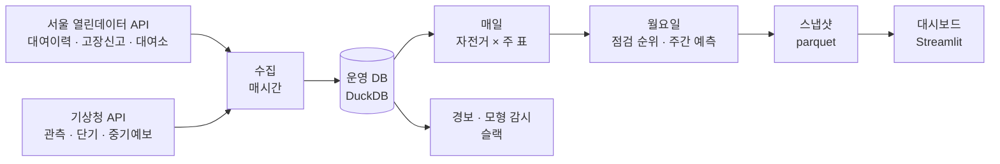

# 따릉이 고장신고 분석

서울시 공공자전거 따릉이에는 최근 5년 동안 한 해 10만 ~ 16만 건의 고장신고가 들어왔다(2024년 141,337건, 2025년 97,838건). 공개 자료만으로 그 신고가 왜 늘고 주는지를 따져 본 개인 프로젝트다. 다음 주에 유형별로 몇 건이 들어올지, 어느 자전거부터 볼지를 정비 담당자에게 보여 주는 화면까지 만들었다. 화면은 <https://ttareungi-care.duckdns.org>에 있다(서울시·서울시설공단과 무관한 비공식 화면).

결과부터 적으면 이렇다.

- 신고 건수 변동의 70 ~ 85%는 대여량 하나로 설명된다. 그래서 건수 대신 대여 1만 건당 신고 건수(신고율)를 봤다.
- 주간 예측에서는 검증에서 고른 모형이 테스트에서 "지난주 값 그대로"라는 단순 기준에 졌다(체인 −17.2%, 페달 −19.4%). 원인을 찾아 더 단순한 구조로 바꿨고, 그 구조의 오차율은 2024년 검증에서 11.8%, 단순 기준은 17.3%다.
- 자전거별 점검 순위의 상위 1,000대 가운데 12.4%가 다음 주에 신고됐다. 무작위로 고르면 4.1%, 최근 주행거리 순이면 11.2%다.


2026-09-29부터 10-10까지 했다. 코드 작성과 반복 실행은 Claude Code에 맡겼고, 문제 정의와 기준값, 모형 선택, 테스트를 여는 시점은 직접 정했다([작업 방식](#작업-방식)).

## 왜 다시 했나

수업 팀 프로젝트에서 같은 주제를 한 번 다뤘다. 그때는 신고 건수를 그대로 예측했는데, 다시 보니 건수는 대부분 이용량을 따라가고 있었다. 2021-04 ~ 2024년의 일별 자료에서 신고 건수와 대여 건수의 상관은 0.887인데, 대여 1만 건당 신고 건수(이하 신고율)와 대여 건수의 상관은 0.050이다. 건수를 맞히는 모형은 자전거를 많이 타는 날을 맞히고 있었던 셈이다. 그래서 질문을 셋으로 나눠 다시 세웠다.

1. 이용량을 걷어 내면 신고율은 무엇에 따라 움직이나.
2. 다음 주 신고 건수를, 지난주 값을 그대로 쓰는 예측(이하 단순 기준)보다 잘 맞힐 수 있나.
3. 자전거 한 대 한 대에 신고 가능성의 순서를 매길 수 있나.

고장신고는 이용자가 앱에서 넣은 신고일 뿐 확인된 고장이 아니고, 정비·수리 이력은 공개돼 있지 않다. 따라서 이 저장소의 모형이 맞히는 것은 고장 날 자전거가 아니라 신고가 들어올 자전거다.

## 알아낸 것

### 신고 건수는 대부분 이용량을 따라간다

주간 신고 건수 변동 가운데 대여량 하나로 설명되는 몫은 유형에 따라 70 ~ 85%다. 이용량을 걷어 낸 신고율에서 크게 움직이는 것은 셋이었다. 하나는 수준이 계단처럼 바뀌는 것으로, 바로 아래에서 다룬다. 둘째는 타이어의 계절성이다. 타이어 신고율은 8월이 2월의 2.4배다(연평균을 100으로 둔 월 지수로 2월 66, 8월 158). 셋째는 한파로, 일평균 기온이 −4℃ 이하인 날은 신고율이 1.41배였다(95% 신뢰구간 1.27 ~ 1.58). 요일 효과는 작지만 기간을 바꿔도 같았다(토요일은 월요일의 0.83배). 더위와 전날 비는 효과가 없거나 작았다.

### 신고율은 계단처럼 바뀐다. 2025년의 하락은 신고가 준 쪽으로 보인다

신고율의 수준은 서서히 변하기보다 어느 날 한꺼번에 바뀐다. 2021년 4월 초에는 며칠 사이에 2배가 됐다. 2025년에는 3월부터 내려가, 상반기 신고율이 전년 상반기의 0.83배였다.

2025년의 하락이 실제로 고장이 줄어서인지 보려고, 신고와 상관없이 대여 기록에 남는 고장의 흔적을 찾았다. 빌린 대여소에 2 ~ 3분 만에 그대로 반납한 대여다. 타려다 그만둔 것으로 볼 수 있어 이 저장소에서는 헛대여라고 부른다. 2024년 상반기와 2025년 상반기를 비교하면 헛대여율은 0.93배로 거의 그대로였다. 그런데 헛대여가 있었던 자전거가 그날이나 다음 날 신고된 비율은 13.3%에서 8.7%로 떨어졌다. 고장은 비슷하게 나는데 신고를 덜 하게 된 것으로 보인다.

이 해석에는 단서가 붙는다. 헛대여가 고장을 대신한다는 것은 가정이고, 테스트 구간을 본 뒤에 한 사후 분석이다. 무엇이 신고를 줄였는지(앱의 신고 경로가 바뀌었는지 등)는 공개 자료로 확인하지 못했다.

### 주간 예측에서는 공들인 모형이 단순 기준에 졌다

과제는 전체와 네 유형(타이어, 체인, 안장, 페달) 각각의 앞으로 7일 신고 건수를 맞히는 것이다. 매일을 예측 시점으로 삼아 채점했고, 오차율은 평균 절대오차를 실제 건수의 평균으로 나눈 값이다. 음이항 회귀, LightGBM, ARIMAX, GRU를 비교했다. 2024년 검증에서는 음이항 회귀와 GRU가 엇비슷하게 좋았고, 더 단순한 음이항 회귀로 통일했다. 이 모형은 검증에서 단순 기준보다 오차를 31.6 ~ 40.8% 줄였다.

모형과 설정을 커밋으로 고정한 뒤 2025 ~ 2026년 상반기 테스트를 한 번 열었다. 오차를 줄인 폭은 안장이 27.6%로 뚜렷했고 타이어는 2.8%로 단순 기준과 비슷했다. 체인과 페달은 오차가 오히려 17.2%, 19.4% 늘었고 전체도 2.4% 늘었다.

원인은 위의 계단이었다. 모형에 넣은 최근 4주 신고율의 계수가 0.62 ~ 0.91로 1보다 작아서, 수준이 내려간 뒤에도 예측이 그만큼 내려가지 않았다. 검증 구간인 2024년은 학습 구간의 마지막 해와 수준 차이가 작아서 이 약점이 드러나지 않았다.

같은 테스트에서 최근 4주 신고율에 대여량 예측을 곱하는 훨씬 단순한 구조는 전체와 네 유형 모두에서 단순 기준보다 오차가 15.0 ~ 26.6% 작았다. 운영에는 이 구조를 쓰고, 유형을 단말기와 기타까지 일곱으로 늘렸다. 2024년 검증에서 전체 신고의 오차율은 11.8%이고 단순 기준은 17.3%다.

다만 이 구조는 테스트 결과를 본 뒤에 골랐다. 테스트가 끝난 뒤의 13주(2026년 7월 ~ 10월 초)를 같은 코드로 다시 돌려 보면 12.3%(단순 기준 21.0%)인데, 이것도 지나간 기간을 뒤늦게 돌린 것이다. 실제 운영 성적은 2026년 10월 12일 주부터 따로 쌓는다.

### 점검 순위 상위의 신고 비율은 무작위의 3배, 주행거리 순보다 조금 높다

대여이력 1.23억 건으로 자전거 × 주 표(548만 행)를 만들었다. LightGBM으로 주행거리 1km당 신고 위험을 맞추고(포아송, 주행거리를 offset으로), 거기에 최근 4주 평균 주행거리를 곱한 다음 주 기대 신고 수 순으로 줄을 세웠다. 2026년 상반기 테스트에서 상위 1,000대 가운데 다음 주에 실제로 신고된 자전거는 12.4%였다. 무작위로 고르면 4.1%, 최근 주행거리 순으로만 줄을 세워도 11.2%다. 많이 탄 자전거가 많이 신고된다는 사실이 대부분을 설명한다. 1,000대를 볼 때 모형은 123.5대, 주행거리 순은 112.4대를 잡아서 모형이 더하는 몫은 11대다.

모형과 별개로 단순한 경보 하나를 같이 봤다. 대여 두 번이 잇달아 헛대여로 끝난 경우다. 2026년 상반기에 707번 있었고, 그 가운데 31.7%가 7일 안에 신고됐다(같은 기간 아무 대여나 골랐을 때는 6.8%). 그 앞 기간(2023-07 ~ 2025-12)에는 46.0%였는데 비교 대상인 6.8%도 그때는 8.9%였다. 신고까지 앞선 시간의 중앙값은 12시간이다. 미리 알려 주는 신호라기보다, 신고가 들어오지 않은 나머지 자전거를 찾는 데 쓸모가 있다.

### 주요 숫자

| 지표 | 결과 | 비교 | 기간 | 출처(`output/tables/`) |
| --- | --- | --- | --- | --- |
| 주간 신고 예측의 오차율, 운영 방식. 전체(괄호는 유형별 범위) | 11.8% (12.3 ~ 15.0%) | 단순 기준 17.3% (17.8 ~ 20.2%) | 2024 검증 | `fc_ops_replay_valid.csv` |
| 같은 방식을 테스트 뒤 13주에 다시 돌린 것(실시간 기록 아님) | 12.3% (6.7 ~ 20.1%) | 단순 기준 21.0% (16.7 ~ 28.5%) | 2026-07-06 ~ 10-04 | `fc_ops_compare_live.csv` |
| 검증에서 고른 모형이 단순 기준보다 오차를 줄인 폭(전체 / 타이어 / 체인 / 안장 / 페달). 음수면 단순 기준보다 나쁨 | −2.4% / 2.8% / −17.2% / 27.6% / −19.4% | 2024 검증에서는 36.1% / 40.8% / 31.6% / 38.4% / 34.4% | 2025 ~ 2026-06 테스트 | `fc_test_vs_valid.csv` |
| 점검 순위 상위 1,000대의 다음 주 신고 비율 | 12.4% | 무작위 4.1%, 주행거리 순 11.2% | 2026 상반기 테스트 | `risk_eval_test.csv` |
| 헛대여가 두 번 잇달은 뒤 7일 안 신고 비율 | 31.7% | 아무 대여 뒤 6.8% | 2026 상반기 | `risk_alert_by_year.csv` |

이 저장소에서 인용하는 숫자는 모두 스크립트가 `output/tables/`에 저장한 표에서 온다.

## 검증에서 지킨 것

- 구간을 먼저 정하고 바꾸지 않았다. 주간 예측은 학습 2021-04-08 ~ 2023, 검증 2024, 테스트 2025 ~ 2026-06이다. 자전거별 모형은 학습 2024-01 ~ 2025-06, 검증 2025-07 ~ 12, 테스트 2026-01 이후다.
- 테스트는 모형과 설정을 고정한 뒤 한 번만 열었다. 주간 예측 모형은 테스트 결과가 나빴지만 고치지 않았고, 그 결과를 그대로 적었다.
- 모든 결과를 단순한 비교 대상(지난주 값 그대로, 무작위, 주행거리 순)과 나란히 놓았다.
- 테스트를 본 뒤에 한 분석(신고율 하락의 원인, 강건성 점검)은 사후 분석으로 구분했고 모형을 고르는 데 쓰지 않았다.
- 운영 코드와 분석 정의에 시험 13개를 붙였고 푸시할 때마다 GitHub Actions에서 돈다.

## 한계

- 신고는 고장이 아니다. 정비 이력이 없어서 점검 순위가 실제 고장을 얼마나 잡는지는 이 자료로 알 수 없다.
- 신고율 수준이 바뀐 직접 원인을 모른다. 다음에 또 바뀌면 주간 예측은 몇 주 동안 틀린다. 최근 4주 신고율을 그대로 쓰는 구조는 그 기간을 줄이려고 고른 것이다.
- 자전거별 모형은 주행거리 순과 차이가 작다. 현장에서 써 보기 전에는 그 차이가 일의 양을 바꿀 만큼인지 말할 수 없다.
- 2020 ~ 2022년 초에 자전거번호가 새로 붙어서, 그 전에 들어온 자전거의 나이를 모른다.
- 서버 한 대와 파일 하나짜리 DB로 돌린다. 지금 규모에는 맞지만 이중화는 없다.

## 만든 것

대여이력과 고장신고는 매시간 받아 DuckDB에 쌓는다. 자전거 × 주 표는 매일, 점검 순위와 주간 예측은 월요일마다 다시 계산해 파일(parquet)로 내보낸다. 화면은 그 파일만 읽는다. 수집이 늦어지거나 계산이 도는 중에도 화면은 마지막으로 내보낸 값을 보여 준다.



화면은 네 개다.

| 화면 | 보여 주는 것 |
| --- | --- |
| 한눈에 보기 | 이번 주 신고 예측과 예측 구간, 지난주 신고율, 점검 권장 대수, 자치구별 분포 |
| 유형별 고장 신고 예측 | 전체·타이어·체인·안장·페달·단말기·기타의 이번 주 예측, 지난 예측이 얼마나 맞았는지 |
| 점검 대상 | 최근 7일 신고 자전거, 점검 순위, 헛대여가 잇달은 자전거. 목록마다 위치 지도 |
| 자전거 조회 | 번호 하나로 그 자전거가 어느 목록에 있는지, 어디에 있는지, 왜 올랐는지 |


운영에 필요한 것도 같이 두었다. 작업은 두 번 돌려도 결과가 같고, 빠진 시간대는 다음 실행에서 따라잡는다. 수집 실패와 자료 이상은 슬랙으로 알린다. 모형은 매주 채점해 기록하고, 언제 다시 맞출지의 기준을 미리 정해 두었다(`docs/pipeline.md`). 2026-10-10부터 서버 한 대(AWS Lightsail, 서울)에서 돈다.

## 저장소 구성

```text
dareungi/
├─ py/            공용 모듈과 단계별 스크립트
│  ├─ build/      원본 정리, 일별 집계
│  ├─ panel/      대여이력 적재, 자전거 × 주 표
│  ├─ forecast/   주간 예측, 기상청 예보 정리, 강건성 점검
│  ├─ risk/       자전거별 모형, 평가, 해석
│  ├─ regime/     신고율 하락의 원인 분석
│  └─ jobs/       운영 작업(수집, 매시간·매일·매주 갱신, 감시)
├─ app/           대시보드(Streamlit)
├─ notebooks/     단계별 노트북(사전검증, 탐색, 회귀, 예측)
├─ tests/         운영 회귀 시험, 분석 정의 시험, 화면 시험
├─ deploy/        서버 설치 스크립트와 설정
├─ output/        표·그림·모형 설정(인용하는 숫자의 출처)
└─ docs/          결정 로그, 단계별 메모, 보고서 초안, 운영 문서
```

원본 데이터와 운영 DB는 용량 때문에 저장소에 없다. 일별로 정리한 분석용 표(`data/processed/daily_master_v2`, 3,834일 × 75열)는 들어 있어서 회귀 단계는 이것만으로 다시 돌릴 수 있다. 예측 단계에서 기상청 예보를 쓰는 부분은 따로 받은 예보 파일이 더 필요하다.

## 실행

```bash
git clone https://github.com/Junyeop-Shin/dareungi.git && cd dareungi
python3 -m venv .venv && source .venv/bin/activate
pip install -r requirements.txt

python tests/test_ops.py        # 운영 작업 회귀 시험 10개
python tests/test_analysis.py   # 신고·대여를 세는 정의 시험 3개
```

대시보드와 운영 작업은 인증키(`.env`, 예시는 `.env.example`)와 운영 DB가 있어야 돈다. 서버에 올리는 순서는 `deploy/README.md`에 있다.

```bash
streamlit run app/admin/Home.py --server.port 8501
```

## 문서

| 문서 | 내용 |
| --- | --- |
| [`docs/report_stage1.md`](docs/report_stage1.md) | 신고율 분석과 주간 예측 보고서(초안) |
| [`docs/risk_model_card.md`](docs/risk_model_card.md) | 자전거별 모형의 용도, 평가, 한계 |
| [`docs/notes/`](docs/notes/) | 단계별 메모. 무엇을 어떻게 왜 처리했는지 |
| [`docs/decision_log.md`](docs/decision_log.md) | 결정 90건과 그때 본 숫자, 버린 대안 |
| [`docs/pipeline.md`](docs/pipeline.md) | 운영 작업표, 경보, 재학습 기준 |
| [`docs/STATUS.md`](docs/STATUS.md) | 지금 상태와 남은 일 |

## 작업 방식

코드 작성과 반복 실행, 검증 계산에는 Claude Code를 썼다. 문제 정의, 기준값과 임계값, 자료를 넣고 빼는 기준, 모형 선택, 테스트를 여는 시점은 직접 정했고, 그 결정을 근거 숫자와 함께 결정 로그에 남겼다. 역할을 나눈 방식은 [`docs/WORKFLOW_사람-AI_역할분담.md`](docs/WORKFLOW_사람-AI_역할분담.md)에, 작업 규칙은 [`CLAUDE.md`](CLAUDE.md)에 있다.

## 자료 출처

서울 열린데이터광장(OA-15644 고장신고, OA-15182 대여이력, OA-15246 이용정보, 일별 대여건수), 기상청 ASOS·단기예보·중기예보와 특일정보(공공데이터포털). 서울시 자료는 공공누리 1유형(출처 표시)이다. 자치구 경계는 통계청 센서스용 행정구역경계 2013(github.com/southkorea/seoul-maps, Apache 2.0)을 썼다.
